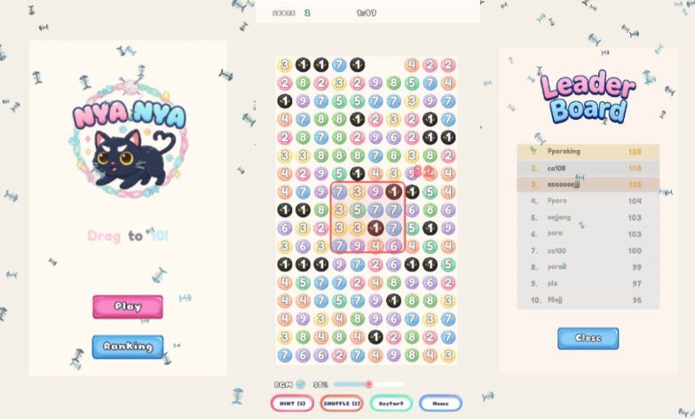

# NYA NYA (사과게임) - Unity WebGL

숫자의 합이 10이 되도록 드래그해 공을 없애는 퍼즐 게임입니다.
2007년 일본의 원작 사과게임을 Unity WebGL로 재구현했습니다.

플레이: https://nya-nya.vercel.app/



## 게임 규칙

1. 10x17 그리드에 1~9 숫자가 적힌 공 170개가 배치됩니다
2. 마우스/터치로 드래그하여 사각형 영역을 선택합니다
3. 선택 영역 내 숫자의 합이 **정확히 10**이면 공이 제거됩니다
4. 제거된 공 위의 공은 아래로 떨어집니다
5. 제한 시간은 2분입니다

## 원작 대비 추가 기능

- **실시간 합계 표시**: 드래그 중 선택된 숫자의 합을 표시
- **힌트**: 유효한 조합을 하이라이트 (게임당 3회)
- **셔플**: 남은 공의 위치를 섞기 (게임당 2회)
- **콤보**: 3초 안에 연속 성공 시 점수 배율 증가 (콤보당 +15%)
- **온라인 랭킹**: 게임 종료 후 닉네임·점수·콤보를 Firestore에 제출, 상위 10명 표시

## 개발 과정: AI에 맡길 범위 조정

코드를 직접 쓰지 않는 것을 목표로 시작했고, 처음에는 UI 전체를 `UIManager`가 코드로 생성했습니다.
이 구조에서는 버튼의 위치·색상·크기가 코드에 하드코딩되어 있어, 버튼 하나를 고쳐 달라고 요청하면 AI가 라벨 텍스트로 대상을 추측하다 다른 부분을 수정하는 일이 반복됐습니다.

그래서 역할을 나눴습니다.

- **시각적 조정 (직접)**: 메인·HUD·결과창의 버튼과 텍스트를 `[SerializeField]`로 노출해 Inspector에서 배치와 값을 조정
- **기능·로직 (AI)**: 코드는 할당된 버튼에 동작을 연결하는 역할만 담당. 수정 요청은 "이 버튼의 이 동작"처럼 기능 단위로 지목

Inspector에 할당되지 않은 요소는 기존처럼 코드로 생성됩니다.

## 프로젝트 구조

```
Assets/
├── Scripts/
│   ├── AppleGameSetup.cs          # 씬 부트스트래퍼 (카메라, 매니저, UI, 배경 생성)
│   ├── GameManager.cs             # 게임 상태, 타이머, 힌트/셔플 횟수
│   ├── GridManager.cs             # 그리드 생성/관리, 낙하, 힌트 탐색, 셔플
│   ├── Apple.cs                   # 개별 공 (숫자, 색상, 애니메이션)
│   ├── DragSelector.cs            # 드래그 입력, 선택 영역, 실시간 합계
│   ├── ScoreManager.cs            # 점수, 콤보
│   ├── UIManager.cs               # UI 패널 (메뉴, HUD, 카운트다운, 결과, 리더보드)
│   ├── AudioManager.cs            # BGM, 효과음
│   ├── ThemeManager.cs            # 밝은/어두운 테마
│   ├── FirebaseManager.cs         # 랭킹 제출/조회 (WebGL은 JS 브리지 경유)
│   ├── LocalLeaderboardManager.cs # 로컬 랭킹 저장 (PlayerPrefs)
│   ├── LeaderboardEntry.cs
│   ├── ParticleAutoDestroy.cs
│   └── Editor/
│       └── AppleGameSetupEditor.cs
├── Plugins/WebGL/
│   └── FirebaseBridge.jslib       # C# ↔ Firebase JS SDK 브리지
├── WebGLTemplates/Firebase/
│   └── index.html                 # Firebase JS SDK를 로드하는 WebGL 템플릿
└── Scenes/
    └── SampleScene.unity
```

## 랭킹 구조

```
[WebGL 빌드]
FirebaseManager (C#)
  └─ DllImport → FirebaseBridge.jslib
       └─ Firebase JS SDK (compat 10.12.2, WebGL 템플릿에서 로드)
            ├─ 익명 인증
            └─ Firestore `leaderboard` 컬렉션 (제출 / 상위 N개 조회)
       └─ SendMessage로 결과를 C#에 전달

[에디터 / 네이티브 빌드]
FirebaseManager → Firebase Unity SDK (Auth, Firestore)
```

설정 방법은 [FIREBASE_WEB_SETUP.md](FIREBASE_WEB_SETUP.md)(WebGL), [FIREBASE_SETUP.md](FIREBASE_SETUP.md)(Unity SDK)에 정리했습니다.

## 실행 / 빌드

1. Unity 6 (6000.0.58f2)로 프로젝트를 엽니다
2. `Assets/Scenes/SampleScene.unity`를 열고 Play
3. WebGL 빌드: `Build Settings`에서 WebGL로 전환 → `Player Settings` → `Resolution and Presentation` → WebGL Template을 `Firebase`로 선택 → Build
4. 빌드 결과물을 정적 호스팅(현재 Vercel)에 배포

## 기술 스택

- Unity 6 (6000.0.58f2), Universal Render Pipeline (2D)
- Input System (마우스 + 터치 통합), TextMeshPro
- Firebase (Anonymous Auth, Firestore), WebGL `.jslib` 브리지
- Vercel (배포)
